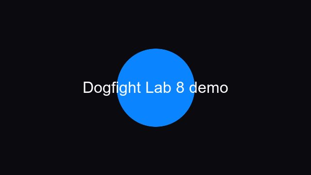

# Dogfight — Lab 8: Docker, метрики і публікація

[](.github/workflows/lab-08.yml)



Мережева multiplayer-гра на TypeScript без фреймворку: сервер авторитетно рахує стан, клієнт передає лише input, а WebSocket синхронізує двох гравців у спільній кімнаті.

> **Live URL:** `https://REPLACE_WITH_HOST`
>
> **WebSocket:** `wss://REPLACE_WITH_HOST/ws`
>
> Ці два значення потрібно замінити після фактичного деплою. Цей архів містить Docker і release pipeline, але не має доступу до вашого GitHub/хостингу, тому не вигадує публічну адресу або RTT.

## Запуск локально

```bash
nvm use
npm ci
npm run dev
# http://localhost:5173
```

Production-like запуск без Docker:

```bash
npm run build:server
npm run build
GIT_SHA=$(git rev-parse HEAD) \
ALLOWED_ORIGINS=http://localhost:4173 \
CLIENT_DIST="$PWD/client/dist" \
node dist/server/index.js
```

Перевірки:

```bash
curl http://localhost:3000/health
curl http://localhost:3000/ready
curl http://localhost:3000/metrics
npm run typecheck
npm run lint
npm run format:check
npm test
npm run coverage:shared
npm run build:server && npm run build
```

## Docker

Образ має два етапи: builder встановлює всі залежності, компілює сервер у `dist/server/index.js` і збирає Vite-клієнт; runtime містить лише Node, production-залежності, bundle та `client/dist`.

```bash
docker build --build-arg GIT_SHA="$(git rev-parse HEAD)" -t dogfight:lab-08 .
docker run --rm --name dogfight \
  -p 3000:3000 \
  -e ALLOWED_ORIGINS=https://REPLACE_WITH_HOST \
  -e GIT_SHA="$(git rev-parse HEAD)" \
  dogfight:lab-08
```

У фінальному stage:

- процес запускається як `node dist/server/index.js`, а не `npm start`, тому SIGTERM доходить до Node;
- використовується непривілейований користувач `node`;
- є `HEALTHCHECK` на `/health`;
- `CLIENT_DIST`, `LOG_DIR`, `PORT` і `GIT_SHA` задаються через environment;
- dev-залежності не встановлюються (`npm ci --omit=dev`);
- перевірка розміру: `docker image inspect dogfight:lab-08 --format '{{.Size}}'` — ціль менше 200 MB.

Smoke test graceful shutdown:

```bash
docker run -d --name dogfight -p 3000:3000 dogfight:lab-08
curl --fail http://localhost:3000/health
 time docker stop --time=10 dogfight
# exit code контейнера має бути 0, клієнти отримують shutdown і close 1001
```

`docker-compose.yml` містить той самий `stop_grace_period: 10s`.

## Production contract

### `/health`, `/ready`, `/metrics`

- `/health` відповідає, поки Node-процес живий, і повертає `gitSha`, uptime, кімнати, сокети та RSS.
- `/ready` повертає 200, поки сервер приймає гравців; під час SIGTERM спочатку переходить у `503 draining`, а потім закриває сокети.
- `/metrics` віддає Prometheus text format: гравці, кімнати, WebSocket-сесії, messages/s, bytes/s, час simulation step, оцінку event-loop utilization, RSS і кількість виміряних кроків.

Приклад:

```text
dogfight_players 2
dogfight_rooms 1
dogfight_messages_per_second 4.120
dogfight_bytes_per_second 512.000
dogfight_step_ms 0.1800
dogfight_process_rss_bytes 87416832
```

### SIGTERM

Порядок зупинки:

1. `/ready` стає `503` — нові гравці не повинні заходити.
2. Усі WebSocket-клієнти отримують control-повідомлення `{ "type": "shutdown" }`.
3. Сокети закриваються кодом `1001`.
4. Ticker-и зупиняються, match logs і JSON server log дописуються.
5. Процес завершується з кодом 0; timeout Docker — 10 секунд.

Клієнт після `shutdown` закриває поточну сесію і повертається в lobby. Якщо сервер зникає без shutdown, reconnect logic пробує підключення з exponential backoff.

### Origin, limits і логування

Конфіг проходить Zod:

| Environment              | Значення за замовчуванням | Призначення                                                          |
| ------------------------ | ------------------------- | -------------------------------------------------------------------- |
| `PORT`                   | `3000`                    | HTTP/WebSocket порт                                                  |
| `ALLOWED_ORIGINS`        | `*` для local dev         | Список Origin через кому; у production вказати точний `https://host` |
| `MAX_CONNECTIONS_PER_IP` | `32`                      | Ліміт handshake-ів з однієї IP                                       |
| `MAX_ROOMS`              | `100`                     | Ліміт кімнат                                                         |
| `ROOM_MAX_PLAYERS`       | `8`                       | Ліміт гравців у кімнаті                                              |
| `RATE_PER_SEC`           | `10`                      | Ліміт control/chat повідомлень                                       |
| `INPUT_RATE_PER_SEC`     | `60`                      | Ліміт input кадрів                                                   |
| `GIT_SHA`                | `dev`                     | SHA, що видно в `/health` і логах                                    |

На WebSocket handshake сервер звіряє `Origin`. У production wildcard не використовується. JSON-логи пишуться через pino, один JSON-рядок на подію, з `room` і `player`, але без `password`, `token`, `secret`, `key` та `authorization`.

## Архітектура

```mermaid
flowchart LR
  A[Browser A] -- wss:// --> P[Reverse proxy]
  B[Browser B] -- wss:// --> P
  P -- HTTP + Upgrade --> S[One Node process]
  S --> R[RoomRegistry]
  R --> G[RoomGame / 30 Hz ticker]
  G --> SH[shared deterministic simulation]
  S --> M[/metrics]
  S --> L[pino JSON logs]
```

Гравці однієї кімнати завжди живуть в одному Node-процесі: `RoomGame` має один authoritative `World` і один ticker. Горизонтальне масштабування без sticky routing або room broker не вмикаємо, бо тоді два процеси мали б різні копії стану.

За reverse proxy потрібно передати Upgrade:

```nginx
location /ws {
  proxy_pass http://dogfight:3000;
  proxy_http_version 1.1;
  proxy_set_header Upgrade $http_upgrade;
  proxy_set_header Connection "upgrade";
  proxy_set_header Host $host;
  proxy_set_header X-Forwarded-Proto https;
}
location / {
  proxy_pass http://dogfight:3000;
}
```

Публічна сторінка має `https://`, тому клієнт використовує лише `wss://`; mixed content із `ws://` не допускається.

## Failure scenarios

У репозиторії перевірені такі сценарії:

- клієнт зникає під час матчу — server `close` прибирає player і room не тримає socket;
- сервер отримує SIGTERM — shutdown frame, close 1001, logs flush, exit 0;
- сервер зникає — клієнт reconnect-иться і повертається в lobby;
- клієнт шле близько 1000 битих frames/s — protocol/rate limiter закриває тільки цей socket, а ticker інших кімнат не блокується;
- disallowed Origin отримує HTTP 403 до WebSocket upgrade;
- перевищення ліміту IP отримує HTTP 429.

Окремий ручний сценарій для публічної адреси:

```bash
node scripts/rtt.mjs wss://REPLACE_WITH_HOST/ws
```

Після гри з двох різних мереж вставити фактичний результат:

| Учасники            | Мережі                          | RTT p50 | RTT p95 | Дата |
| ------------------- | ------------------------------- | ------: | ------: | ---- |
| Player A + Player B | заповнити після реального тесту |       — |       — | —    |

## PWA

Клієнт має `pwa-manifest.webmanifest`, theme color, SVG icons і service worker. У Chrome/Android або Safari/iOS сторінку можна встановити на головний екран. Service worker кешує shell, але WebSocket завжди залишається network-only.

## Таблиці з Lab 5 і Lab 7

### Lab 5 — розмір і швидкість протоколу

| Сцена                | JSON, bytes | Binary, bytes | JSON encode+decode | Binary encode+decode |
| -------------------- | ----------: | ------------: | -----------------: | -------------------: |
| 2 ships + 0 bullets  |         509 |            65 |            12.8 μs |               5.0 μs |
| 2 ships + 6 bullets  |        1396 |           209 |            26.0 μs |              10.5 μs |
| 8 ships + 24 bullets |        5467 |           809 |           108.7 μs |              44.2 μs |

### Lab 7 — тести та кадр

| Метрика                     |                           Результат |
| --------------------------- | ----------------------------------: |
| Node tests                  |                                  50 |
| Vitest tests                |                                 124 |
| shared statements coverage  |                                85%+ |
| local synthetic profile p50 | див. `artifacts/profile-after.json` |
| local synthetic profile p95 | див. `artifacts/profile-after.json` |
| local synthetic profile p99 | див. `artifacts/profile-after.json` |
| collision algorithm         |                toroidal SpatialHash |
| hot-path object reuse       |             BulletPool + ObjectPool |

Локальні synthetic numbers не підміняють production trace. Для фінального звіту записати Chrome Performance trace з 8 ботами і додати фактичні p50/p95/p99 та GC pause.

## GitHub Actions, GHCR і теги

`.github/workflows/lab-08.yml` запускається на push і pull request: typecheck, assertions, lint, формат, тести, coverage, build server/client, Docker build, `/health`, `/ready`, `/metrics` і `docker stop`.

`.github/workflows/release.yml` запускається тільки на `v*` тегах, збирає образ із `GIT_SHA=${{ github.sha }}` і публікує:

```text
ghcr.io/OWNER/REPOSITORY:v1.0.0
```

Для автоматичного деплою додати repository secrets `DEPLOY_WEBHOOK` і `DEPLOY_TOKEN`. Webhook має оновити immutable image tag і дочекатися `/ready`.

Команди здачі:

```bash
git switch -c lab-08
npm ci
npm run ci
git add .
git commit -m "feat: publish dogfight with Docker metrics and PWA"
git push -u origin lab-08

# після зеленого CI і фактичного deploy
git tag -a lab-08 -m "Lab 08: Docker, metrics and public deployment"
git tag -a v1.0.0 -m "Dogfight v1.0.0"
git push origin lab-08 v1.0.0
```

Тег `v1.0.0` має збігатися з commit, SHA якого показує `/health`; `lab-08` — тег лабораторної на тому самому commit.

## Reflection

- **Чому `/health` і `/ready` різні?** Процес може бути живий, але вже draining і не повинен приймати нові матчі.
- **Чому room не можна просто розділити між процесами?** Один authoritative world має одну послідовність кроків; без broker/affinity процеси розійдуться в стані.
- **Чому `node dist/server/index.js`, а не `npm start`?** У контейнері Node стає PID 1 і отримує SIGTERM напряму, тому graceful shutdown не губиться в npm wrapper.
- **Чому `wss://`, а не `ws://`?** Публічна HTTPS-сторінка не може безпечно відкрити mixed-content WebSocket.
- **Які обмеження залишилися?** Один room — один процес; горизонтальне масштабування потребує sticky routing або зовнішнього state/broker. Ліміти IP можуть обмежувати користувачів за NAT, тому їх треба підбирати за метриками.

## Відео захисту, 3–5 хвилин

Після deploy записати відео: 0:00–1:00 — два браузери з різних мереж за `https://`; 1:00–2:00 — `/health`, `/ready`, `/metrics`; 2:00–3:00 — `docker stop` і повернення клієнтів у lobby; 3:00–4:00 — один тест/Origin або rate limit; 4:00–5:00 — коротко Reflection і фактичний RTT.
